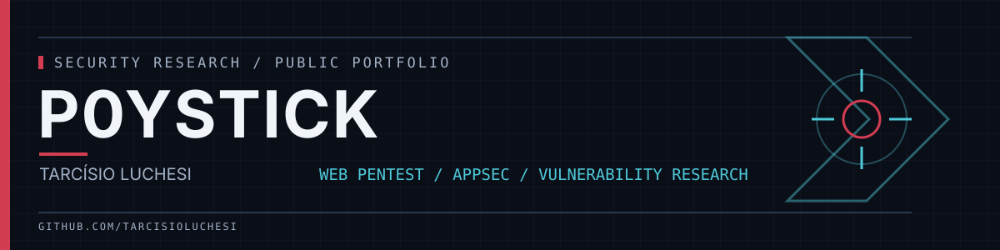

<picture>
  <source media="(prefers-color-scheme: dark)" srcset="assets/profile-banner-dark.svg">
  <source media="(prefers-color-scheme: light)" srcset="assets/profile-banner-light.svg">
  
</picture>

**Tarcísio Luchesi (P0ystick)** — Independent web security researcher focused on application security, WordPress vulnerability research, and penetration testing.

**Open to opportunities:** Web Pentester · Application Security Analyst · Vulnerability Research · Security Research Collaboration

## Research

| Area | Research / finding | Evidence |
| :--- | :--- | :--- |
| **HTML Injection, XSS & CSRF** | Investigated how same-origin injected HTML forms and JavaScript can bypass CSRF defenses relying exclusively on the `Origin` header. Authenticated state changes were reproduced in a **local Flask lab**; account takeover was not demonstrated and depends on additional conditions. | [Merged OWASP WSTG PR #1720](https://github.com/OWASP/wstg/pull/1720) |
| **WordPress · Authorization** | **CVE-2025-15285 / SEO Flow:** documented a missing-authorization case study and built an interactive Python PoC restricted to local/private laboratory targets. | [PoC](https://github.com/TarcisioLuchesi/PoC123/blob/main/pocs/cve_2025_15285_interactive.py) · [Write-up](https://github.com/TarcisioLuchesi/PoC123/blob/main/research/cve-2025-15285.html) |
| **WordPress · Code review** | **Icegram Collect 1.3.21:** traced `review_url` into an unescaped HTML attribute and documented the administrative privileges and nonce required. This is **static analysis**, not proof of an externally exploitable attack path. | [Source-to-sink analysis](https://github.com/TarcisioLuchesi/PoC123/blob/main/research/icegram-collect-1.3.21-review-url-sem-escape.md) |
| **Template security · CTF** | Studied a Handlebars-based template-processing challenge, mapping user-controlled template inputs to an Express/Node.js backend. | [Technical notes](https://github.com/TarcisioLuchesi/PoC123/blob/main/research/cve-2026-33938-handlebars-ctf.md) |
| **WordPress · XSS** | Paytium version comparison and XSS research notes. | [Case study](https://github.com/TarcisioLuchesi/PoC123/blob/main/research/paytium-5-0-3-5-0-5-xss.html) |
| **Black-box testing** | Investigated newsletter consent flows and recorded practical testing hypotheses. | [Methodology](https://github.com/TarcisioLuchesi/PoC123/blob/main/research/black-box-newsletter-consent.html) |

## Open source & documented work

| Project | Contribution | Status |
| :--- | :--- | :--- |
| [OWASP Web Security Testing Guide](https://owasp.org/www-project-web-security-testing-guide/) | Added guidance for testing the impact of same-origin HTML Injection and XSS on Origin-based CSRF defenses. | **[PR #1720 — merged](https://github.com/OWASP/wstg/pull/1720)** |
| [Security research portfolio](https://github.com/TarcisioLuchesi/PoC123) | Public lab PoCs, technical write-ups, source review notes, and testing methodology. | Published |
| [WordPress testing methodology](https://github.com/TarcisioLuchesi/PoC123/blob/main/wordpress-methodology.html) | Practical methodology for WordPress research. | Published |

## Skills

| Focus | Stack and tools |
| :--- | :--- |
| Web application security | XSS, HTML Injection, CSRF, access control, SQLi, SSRF, business logic, WordPress security |
| Research workflow | Source review, black-box validation, source-to-sink tracing, controlled proof-of-concept development, responsible disclosure |
| Development & testing | Python, JavaScript, PHP/WordPress, HTTP, Burp Suite, browser DevTools, Git, Linux/WSL |

## Contact

**GitHub:** [TarcisioLuchesi](https://github.com/TarcisioLuchesi) · **X / Research:** [@P0ystick](https://x.com/P0ystick)

---

## 🇧🇷 Em português

Sou **Tarcísio Luchesi (P0ystick)**, pesquisador independente de segurança de aplicações web, com foco em **pentest web, segurança WordPress, análise de código e pesquisa de vulnerabilidades**. Tenho interesse em oportunidades profissionais de **pentest, AppSec e pesquisa de segurança**.

### Pesquisas e contribuições

| Tema | Trabalho | Referência |
| :--- | :--- | :--- |
| HTML Injection / XSS / CSRF | Validei em laboratório Flask a hipótese de que formulários HTML injetados na própria origem podem contornar defesas CSRF baseadas exclusivamente no cabeçalho `Origin`. A tomada de conta foi discutida apenas como impacto condicional. | [Contribuição mesclada na OWASP WSTG](https://github.com/OWASP/wstg/pull/1720) |
| WordPress / Autorização | Estudo de caso da CVE-2025-15285, com PoC interativa em Python, limitada a ambientes de laboratório. | [Código e demonstração](https://github.com/TarcisioLuchesi/PoC123/blob/main/pocs/cve_2025_15285_interactive.py) |
| WordPress / Análise estática | Pesquisa sobre o parâmetro `review_url` no Icegram Collect 1.3.21, com pré-requisitos e limitações explicitados. | [Análise técnica](https://github.com/TarcisioLuchesi/PoC123/blob/main/research/icegram-collect-1.3.21-review-url-sem-escape.md) |
| Metodologias de teste | Anotações de pesquisa, procedimentos de teste e estudos de segurança web. | [Portfólio](https://github.com/TarcisioLuchesi/PoC123) |

### Contato profissional

**GitHub:** [TarcisioLuchesi](https://github.com/TarcisioLuchesi) · **X:** [@P0ystick](https://x.com/P0ystick)

---

*Everything here is published for education, defensive awareness and authorized security testing.*

*Todo o conteúdo é destinado a fins educacionais, conscientização defensiva e testes de segurança autorizados.*
